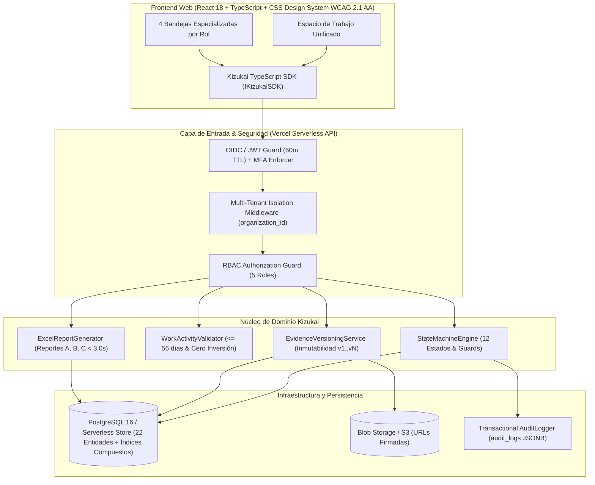
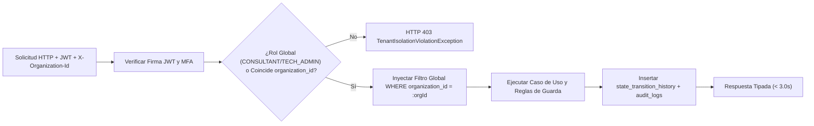
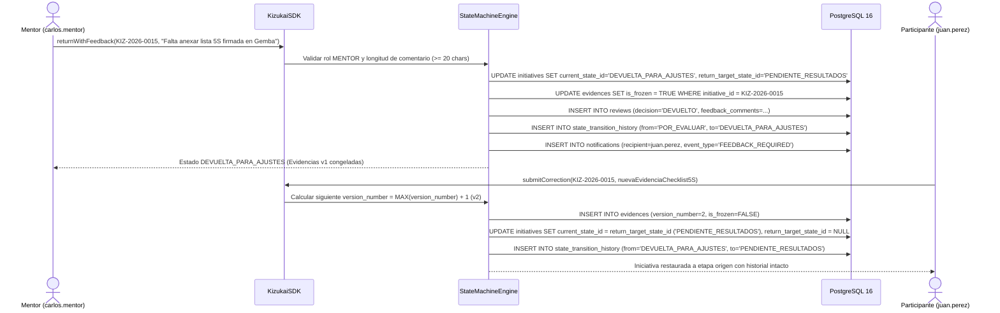
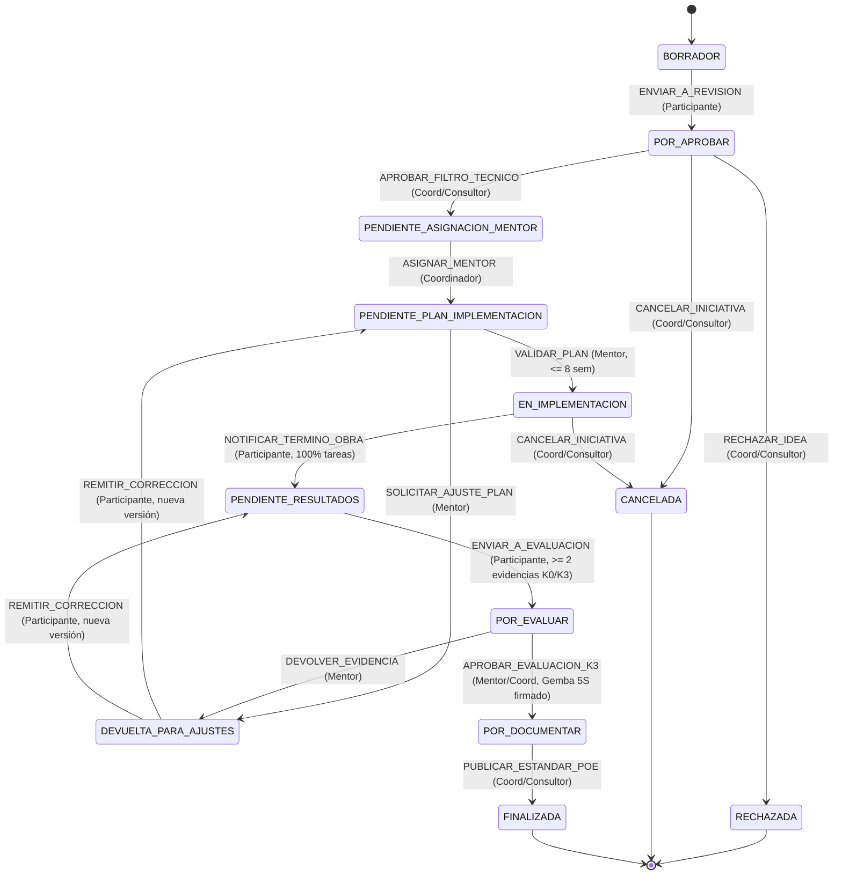

# Especificación de Diseño de Software (SDD): Kizukai Project Hub

## 1. Modelo Matemático y Metodológico Kizukai
El motor de dominio modela las cuatro variables operativas creadas por Alejandro Kasuga Sakai:
- **$K0$ (Estado Deficiente):** Anomalía, desperdicio (*muda*), merma o retrabajo cuantificado en línea base.
- **$K1$ (Funciones Básicas):** Cumplimiento del Procedimiento Operativo Estandarizado (POE) contractual.
- **$K2$ (Proactividad *Ki Wo Tsukau*):** Mejora voluntaria sujeta a dos invariantes duras de backend: **Cero Inversión** (`zero_investment_confirmed = true`) y ventana máxima improrrogable de **8 semanas (56 días)**.
- **$K3$ (Impacto y Beneficio):** Resultado auditado en el *Gemba* (5S) y validado por Finanzas/Costos confrontando $K0$ vs $K3$.

$$V_E = \sum_{i=1}^{n} \left( K1_i + (K2_i \cdot K3_i) \right) - K0$$

## 2. Diagrama de Componentes (Clean / Hexagonal Architecture)

## 3. Diagrama de Flujo de Datos Multi-Tenant

## 4. Diagrama de Secuencia: Devolución Inmutable y Subsanación Incremental

## 5. Máquina de 12 Estados de Negocio

## 6. Matriz RBAC Completa

| Módulo / Funcionalidad | `PARTICIPANT` | `MENTOR` | `COORDINATOR` | `CONSULTANT` | `TECH_ADMIN` |
| :--- | :--- | :--- | :--- | :--- | :--- |
| Registro de Iniciativa | Creación y Edición propia | Solo Lectura | Lectura en su empresa | Lectura global de cohorte | Sin acceso a contenido |
| Aprobación Filtro Técnico | Sin permiso | Solo Lectura | Aprobación / Rechazo | Aprobación / Auditoría | Sin permiso funcional |
| Asignación de Mentor | Sin permiso | Sin permiso | Asignación directa | Asignación / Supervisión | Solo soporte técnico |
| Plan y Actividades | Creación y Edición propia | Revisión y Acompañamiento | Supervisión | Supervisión metodológica | Sin acceso |
| Carga de Evidencias | Carga y Nueva Versión | Solo Lectura | Solo Lectura | Solo Lectura | Gestión de almacenamiento |
| Revisión y Devolución | Recepción y Corrección | Devolución con nota (>=20 chars) | Notificado | Supervisión | Sin acceso |
| Auditoría en Sitio (Gemba 5S) | Firma de conformidad | Carga checklist 5S firmado | Visualización | Validación técnica | Sin acceso |
| Validación Resultados y ROI | Captura de datos duros | Validación técnica | Aprobación con Costos | Aprobación final | Sin acceso |
| Estandarización y Cierre (POE)| Consulta de POE final | Consulta de POE final | Publicación en repositorio | Validación metodológica | Sin acceso |
| Descarga de Reportes Excel | Solo sus iniciativas | Reporte de asignadas | Reportes de su empresa | Consolidados multiempresa | Auditoría técnica |

## 7. Decisiones Arquitectónicas (ADRs)
- **ADR-001 (Aislamiento Multi-Tenant):** Todas las consultas de repositorio exigen `organization_id` validado contra el contexto del actor; cualquier cruce dispara `TenantIsolationViolationException` / `CrossTenantAccessDeniedException` (HTTP 403).
- **ADR-002 (No Regresión Destructiva):** Las devoluciones nunca ejecutan `DELETE` sobre `initiative_stage_instances`, `reviews` ni `evidences`. Se congela la evidencia (`is_frozen = TRUE`) y se guarda `return_target_state_id` para restaurar el flujo exacto tras `REMITIR_CORRECCION`.
- **ADR-003 (Índices Compuestos para SLA < 3.0s):** Se indexan `(organization_id, program_id, current_state_id, created_by_user_id)` para garantizar que las bandejas y la exportación de 5,000 filas del Reporte C respondan en `< 3.0 segundos`.
